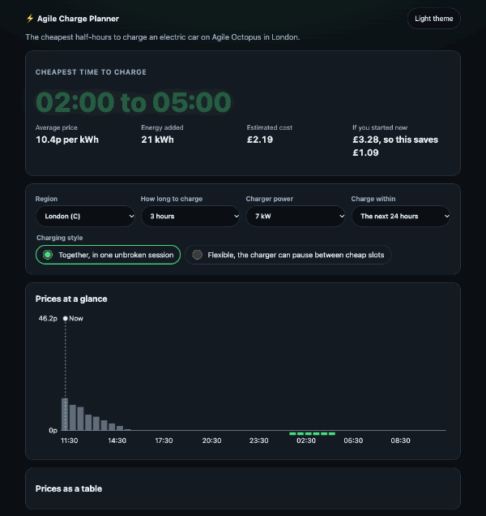

# Agile Charge Planner

[](https://github.com/rveruna/agile-charge-planner/actions/workflows/ci.yml)
[](https://github.com/rveruna/agile-charge-planner/actions/workflows/codeql.yml)

**[Live demo](https://rveruna.github.io/agile-charge-planner/)** (uses the real Octopus Energy prices)

[](https://rveruna.github.io/agile-charge-planner/)

Pick your region and how long you need to charge, and the app finds the cheapest half-hours to charge an electric car
on the Agile Octopus tariff. It shows the plan, what it would cost, what starting now would cost instead, a chart of the
prices and the same prices as a table.

It is an independent project and is not affiliated with Octopus Energy. Prices are shown for information.

## What it does

- Reads the half-hourly Agile prices for any of the 14 regions from Octopus's public REST API (no key needed)
- **Together** finds the cheapest unbroken session. **Flexible** finds the cheapest slots wherever they fall, for a
  charger that can pause
- Works out the energy (kWh), the average price and the cost for a 3.6, 7, 11 or 22 kW charger, and compares it with
  starting now
- Handles negative prices, where you are paid to use electricity
- Shows UK time whatever time zone the viewer is in, including across the clocks changing
- Keeps every choice in the URL, so a link reproduces the view and the back button works
- Saves prices in the browser for 24 hours and says plainly when it is showing saved ones
- Offers clearly labelled sample prices when the live ones cannot be loaded

## Run it

```bash
npm install
npm run dev
npm test               # 147 tests and 43 rule scenarios
npm run test:coverage
npm run build
npm run lint
npm run size           # bundle budget, after a build
npm run perf:lighthouse
```

## How it is built

```
src/
  domain/       prices, the planner, settings, formatting (no React, tested on their own)
  api/          the Octopus client with response validation, and the sample-price generator
  hooks/        URL-backed settings, prices (TanStack Query), the clock
  components/   settings form, status banner, plan summary, chart, table
docs/decisions/ the reasoning behind the main choices
```

- **Server state and user choices are kept apart.** Prices are cached by TanStack Query, keyed by region. Choices live
  in the URL. Changing the length of a charge never refetches ([decision 0001](docs/decisions/0001-server-state-in-the-query-cache-choices-in-the-url.md)).
- **The API response is validated** with Zod, and failures are told apart as network, http or invalid
  ([0002](docs/decisions/0002-validate-the-api-response.md)).
- **The planner is plain functions** (`planCharge`, `cheapestTogether`, `cheapestFlexible`), so the logic is tested
  without a browser.

## Rules

What the app promises is written as plain-English rules that run with the tests
([0007](docs/decisions/0007-the-rules-as-executable-feature-files.md)). A failing rule means the code is wrong, not the
rule.

- [Choosing when to charge](src/domain/choosing-slots.feature): together, flexible, negative prices, "charge within"
  and when the prices do not cover the charge
- [What a charge costs](src/domain/cost.feature): energy, average price and cost, and the saving against starting now
- [Showing times in UK time](src/domain/uk-time.feature): UTC prices shown in UK time across the clocks changing, and
  back-to-back half-hours read as one range

To add a scenario, add a row or a scenario to a feature file and run `npm test`.

## Accessibility

- The chart is a picture with a text description, and the table beside it has every figure. Chosen slots are marked in
  words and by a strip under the axis, not only by colour ([0004](docs/decisions/0004-a-chart-with-a-table-and-a-checked-palette.md)).
- The palette's contrast is tested. The first palette failed that test (the chosen and other bars were 1.14:1 apart),
  and was changed.
- Controls are labelled, the plan result is announced politely, errors use `role="alert"`, and the scrolling chart and
  table can be reached and scrolled by keyboard.
- axe finds no violations in the tests or in real Chrome, and Lighthouse accessibility is 100. I have not tested with a
  screen reader.

## Practices

- **Tests:** 125 (Vitest, Testing Library, MSW for the network). Coverage is 98.9% of statements, 95.9% of branches
  and 97.8% of functions. They include the clocks going back, negative prices, gaps in the data, an unreachable
  service, saved prices when offline and the back button.
- **Mutation check:** I made 24 deliberate changes to the planner, formatting, client and interface logic and ran the
  tests against each. The first run missed 5 (a boundary, a zero-length period, a tie-break, the cache window and the
  axis labels), so I wrote tests for them, and now all 24 are caught. The script is a one-off and is not in the repo.
- **Bugs the checks found in my own work:** a rounding error (59.5p shown as £0.59), the chart palette above, and a
  chart whose labels were about 5px tall on a phone.
- **Quality gates in CI:** an audit of production dependencies, lint, a Prettier check, the build, the tests with
  coverage, a bundle budget (JS 115 kB, CSS 3 kB gzipped) and Lighthouse with minimum scores. A pre-commit hook formats
  and lints staged files. Dependabot and CodeQL are on.
- **Performance:** see [docs/performance.md](docs/performance.md). Lighthouse gives 100 in all four categories on
  simulated Slow 4G, with a 105 kB page.

## Limits and what I would improve

- **The terms of use for the API.** I could not find published terms for Octopus's public rates endpoint. The app
  asks for each region at most once every five minutes, which matches how long Octopus caches the response. Check their
  current terms before building anything commercial on it.
- It uses the current Agile product code, `AGILE-24-10-01`. If Octopus retires it, the app reports an error until the
  constant is changed.
- The cost is the unit rate times energy. It leaves out the standing charge, charger and battery losses, and the car's
  actual state of charge.
- "If you started now" is one unbroken charge from the first slots available. If the prices have a gap in that time,
  it says it is not known rather than pricing a charge that jumps the gap.
- A full offline start needs a service worker, which is not included. Prices already saved do survive a reload.
- Settings that are not a region (length, power and so on) are chosen from fixed lists, not typed in, to keep the
  URL and the validation simple.
